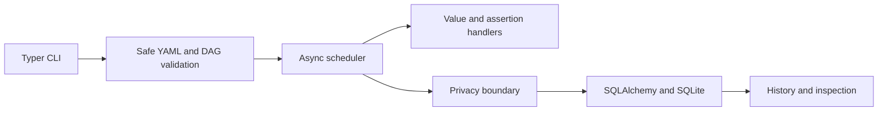

# ForgeFlow

[](https://github.com/ANASS19/forgeflow/actions/workflows/ci.yml)

ForgeFlow is an independent, open-source project building a local-first workflow
execution and debugging system for API developers.

## Current status

**Experimental development checkpoint: `0.1.0.dev0`.** ForgeFlow validates YAML
workflows, explains configuration problems, and executes dependency graphs of
built-in value and assertion steps with persistent local execution evidence.
The broader API-workflow debugging product is actively being developed.

| Capability | Current status |
|---|---|
| Bounded YAML loading and strict Pydantic schema | Working |
| DAG construction, cycle paths, explicit output references | Working |
| CLI validation and static Workflow Doctor | Working |
| Async value/assert execution with bounded concurrency | Working |
| Failure propagation, deadlines, cancellation | Working; experimental |
| SQLite history, inspection, fresh linked runs | Working |
| Abandoned-run recovery and explicit history pruning | Working |
| Atomic attempt events and privacy-filtered output recording | Working foundation |
| HTTP GET/HEAD | Schema validation only; execution is unavailable |
| Bounded retries, full Flight Recorder, offline replay | Planned |
| Shell execution, distributed workers, web UI | Outside the initial MVP |

```text
forgeflow --help
forgeflow --version
python -m forgeflow --help
```

Running `forgeflow` without arguments also displays help. No HTTP requests are
made by this checkpoint. Running an HTTP-containing workflow fails explicitly
before execution or storage initialization.

## Try a working demonstration

After installation, run:

```console
uv run --locked python examples/demo.py
```

This uses the actual CLI and temporary local storage to validate a workflow,
run a successful graph, record an assertion failure, inspect its error code and
skipped dependant, and verify that the independent branch still succeeds. It
also verifies both runs appear in history. No service, API key, or network is needed.

To explore the commands manually:

```console
uv run --locked forgeflow validate examples/values.yaml
uv run --locked forgeflow doctor examples/values.yaml --json
uv run --locked forgeflow run examples/values.yaml --data-dir .forgeflow
uv run --locked forgeflow run examples/assertion-failure.yaml --data-dir .forgeflow
uv run --locked forgeflow history --data-dir .forgeflow
```

The assertion-failure command intentionally exits with status **1**. Copy a run
ID from the output to inspect it or start a fresh linked run:

```console
uv run --locked forgeflow inspect RUN_ID --data-dir .forgeflow --json
uv run --locked forgeflow run examples/values.yaml --parent RUN_ID --data-dir .forgeflow
```

`RUN_ID` is a placeholder for an actual run ID. `--parent` records provenance and
reexecutes every step; it does not reuse earlier outputs. `.forgeflow/` is ignored
by Git. The [CLI reference](docs/cli-reference.md) covers recovery and retention.

## Load a workflow from Python

```python
from forgeflow.workflow import WorkflowLoadError, load_workflow

try:
    workflow = load_workflow("examples/api-health.yaml")
except WorkflowLoadError as error:
    for diagnostic in error.diagnostics:
        print(diagnostic.to_dict())
else:
    print(workflow.name, len(workflow.steps))
```

`parse_workflow(content: bytes)` validates an in-memory UTF-8 document using the
same bounds. Both entry points return typed schema-v1 objects and raise
`WorkflowLoadError` with safe diagnostic codes, locations, and explanations for
invalid input. Loading never sends requests or resolves secrets. Do not log full
workflow objects: successfully loaded literals and request configuration may
contain sensitive data.

See [the workflow reference](docs/workflow-reference.md) for supported fields,
limits, and the deliberately restricted YAML subset. Valid and intentionally
invalid fixtures are in `examples/`.

## Local installation

Requirements: Python 3.12 and [uv](https://docs.astral.sh/uv/). Python 3.13 and later
are not supported by the initial release. `.python-version` selects Python 3.12.10
for this checkout.

Clone the repository, then install from its directory:

```console
git clone https://github.com/ANASS19/forgeflow.git
cd forgeflow
uv sync --locked --no-python-downloads
uv run --locked forgeflow --help
uv run --locked forgeflow --version
```

This installs the package and development dependencies in the local `.venv`.
An existing compatible `.venv` is reused; no global packages are installed. The
first installation requires access to the package index. Validation and static
Doctor checks do not create runtime storage. `run` creates local history lazily.
There is no published PyPI release; install from this checkout.

## Planned MVP

The first MVP is intended to support YAML dependency graphs, HTTP GET/HEAD,
built-in value and assertion execution, bounded retries, persistent history, and
actionable Workflow Doctor diagnostics. An Execution Flight Recorder will retain
minimal metadata and explicitly selected response fields. Offline replay will
fail clearly if required recorded values are unavailable and will never fall
back to live requests. HTTP HEAD steps will not support JSON-body captures.

HTTP execution and replay are not implemented. There is no arbitrary-code or
subprocess workflow action planned for the MVP, and no exactly-once execution
guarantee. See [ROADMAP.md](ROADMAP.md) for completed and upcoming milestones.

## Package structure

- `src/forgeflow/__init__.py`: package version, also used by the build backend.
- `src/forgeflow/cli.py`: Typer application and package-information options.
- `src/forgeflow/__main__.py`: `python -m forgeflow` entry point.
- `src/forgeflow/workflow/`: bounded loader, strict models, and safe diagnostics.
- `src/forgeflow/engine/`: async DAG scheduling and deterministic pure handlers.
- `src/forgeflow/storage/`: SQLAlchemy repository, SQLite migrations, and writer lock.
- `src/forgeflow/recorder/`: privacy filtering and safe recording-plan snapshots.
- `tests/`: CLI, import, distribution metadata, and isolated-install checks.

The architecture is a modular monolith. The scheduler owns execution decisions;
handlers do not write database rows. One storage worker serializes transactions,
and step completion, recorded outputs, and events commit together before any
dependant is released. One mutating process owns each database; steps within its
run may execute concurrently.



See [architecture and failure semantics](docs/architecture.md).

## Current limitations

- This is a work in progress, not a production reliability claim.
- Python 3.12 is the only supported Python series.
- Only value/assert workflows execute. HTTP schemas can be validated, but
  requests, retries, replay, and execution-time Doctor analysis remain planned.
- Recovery marks abandoned work interrupted; it never resumes it automatically.
- Local SQLite storage must be on a local disk, not a network/synchronized folder.
- Stored captured values are plaintext. Filtering is conservative and heuristic;
  it cannot recognize all secrets or personal information. Never put them in
  example workflows or attach private histories to public issues.
- The Python API is evolving; CLI JSON documents carry `output_version: 1`.

## Development

```console
uv lock --check
uv run --locked pytest
uv run --locked ruff check .
uv run --locked ruff format --check .
uv run --locked mypy
uv build --no-sources
uv run --locked python examples/demo.py
```

Build artifacts are written to `dist/`. The test suite also builds an sdist and
wheel, installs the wheel with locked runtime dependencies into a temporary virtual
environment, and exercises it outside the checkout. Those packaging tests use
uv's local cache in offline mode after the initial dependency installation.

See [CONTRIBUTING.md](CONTRIBUTING.md) for development details and
[AGENTS.md](AGENTS.md) for engineering boundaries.

## Security and privacy

Never commit credentials, confidential data, personal data, private recordings,
or environment files. Use synthetic data in tests and examples. The CLI executes
only built-in pure steps; it does not perform network requests. Static Doctor
resolves no secrets unless `--check-env` is explicitly supplied, which checks
presence only. Local development installation may download dependencies.
Read [SECURITY.md](SECURITY.md) before reporting a problem.

## License

Apache License 2.0. See [LICENSE](LICENSE).

Copyright 2026 ForgeFlow contributors.
